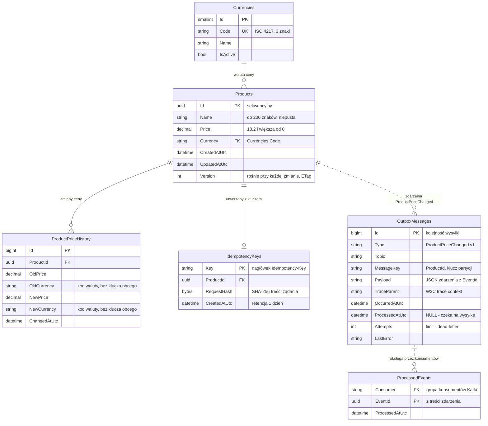

Kolumny i typy są w migracjach ([SQL Server](../../../src/Products.Migrations.SqlServer/Migrations/), [PostgreSQL](../../../src/Products.Migrations.Postgres/Migrations/)) i w skryptach [db/](../../../db/). Baza nazywa się `Products` w SQL Server i `products` w PostgreSQL.

- **Linia ciągła** to klucz obcy w bazie, **przerywana** - powiązanie logiczne bez klucza obcego: zdarzenie w outboxie wskazuje produkt przez `MessageKey`, a konsument zapisuje w `ProcessedEvents` `EventId` odebrany z Kafki (także zdarzenia wariantu na drugiej bazie).
- **Typy są wspólne dla obu baz** (SQL Server / PostgreSQL): `uuid` - `uniqueidentifier` / `uuid`, `string` - `nvarchar`, `char(3)` dla kodów walut, `varchar` dla pól technicznych / `varchar`, `text`; `decimal` - `decimal(18,2)` / `numeric(18,2)`, `datetime` - `datetime2(7)` / `timestamptz`, `bool` - `bit` / `boolean`, `bytes` - `binary(32)` / `bytea`.
- **Pominięta** jest tabela `__EFMigrationsHistory` (historia migracji EF, bez powiązań).

| Tabela | Przeznaczenie | Klucze i indeksy |
|---|---|---|
| `Currencies` | słownik walut - [decyzja](../decisions/currency-dictionary.md) | PK `Id`, unikalny `Code` |
| `Products` | produkty; `Version` rośnie przy każdej zmianie | PK `Id` (sekwencyjny), FK `Currency` → `Currencies.Code`, CHECK: niepusta nazwa i cena > 0; indeks `(CreatedAtUtc, Id)` - [lista od najnowszych](../flows/list-and-delete.md) |
| `ProductPriceHistory` | stara i nowa cena oraz waluta przy każdej zmianie | FK `ProductId`, indeks `(ProductId, ChangedAtUtc)` |
| `OutboxMessages` | zdarzenia do wysłania - [Outbox](../mechanisms/outbox.md) | PK `Id` (kolejność wysyłki); filtrowane: `IX_OutboxMessages_Pending` (niewysłane) i `IX_OutboxMessages_ProcessedAtUtc` (wysłane, retencja) |
| `ProcessedEvents` | zdarzenia obsłużone przez odbiorcę - [Inbox](../mechanisms/inbox.md) | PK `(Consumer, EventId)`, indeks `ProcessedAtUtc` (retencja) |
| `IdempotencyKeys` | klucze POST - [Idempotency-Key](../mechanisms/idempotency-key.md) | PK `Key`, FK `ProductId`, indeks `CreatedAtUtc` (retencja) |
| `__EFMigrationsHistory` | zastosowane migracje EF; zapisują je też skrypty `db/` - [decyzja](../decisions/migrations-source-of-truth.md) | PK `MigrationId` |

Indeksy są tylko jawne: automatyczny indeks na każdym kluczu obcym (np. `Products.Currency` z 3 wartościami) nie przyspiesza odczytów, a spowalnia każdy zapis.

Powiązane: [Migracje EF jako źródło prawdy schematu](../decisions/migrations-source-of-truth.md), [Zmiana schematu bazy](../playbooks/schema-change.md)
